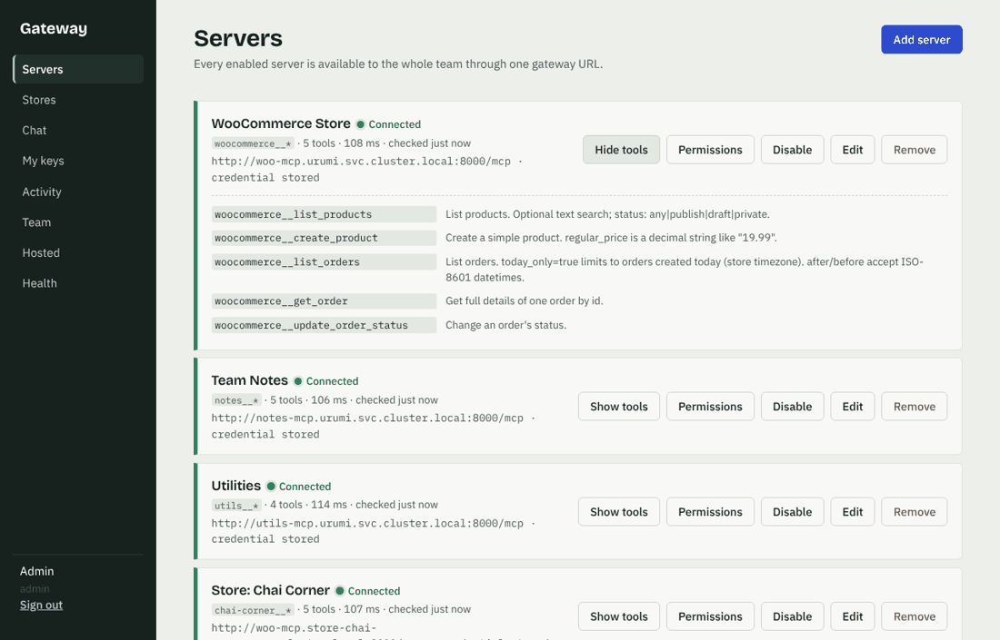
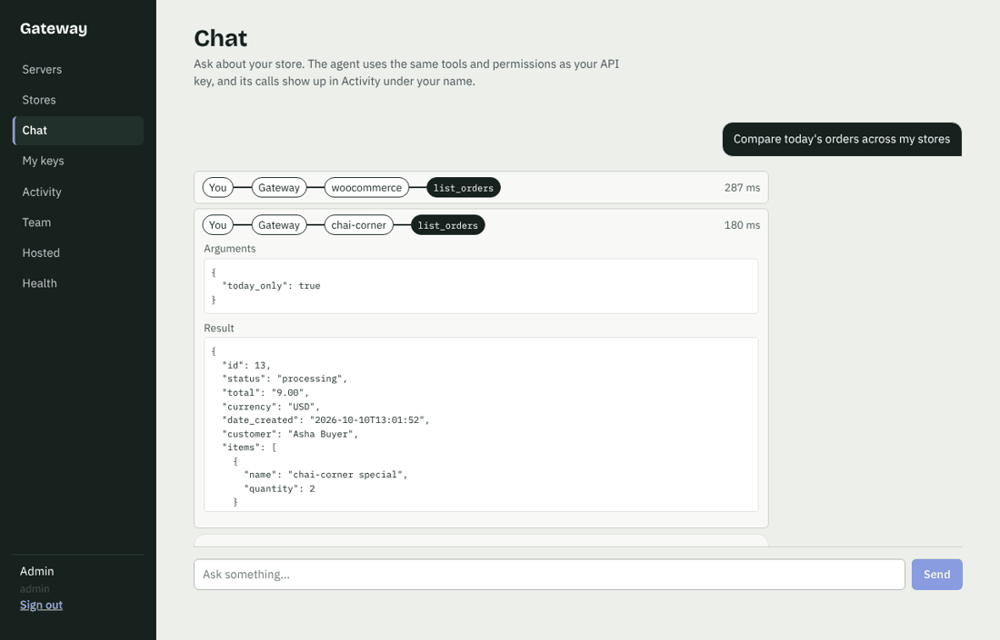
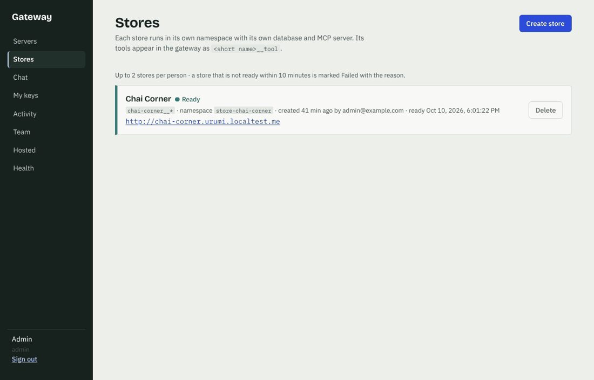
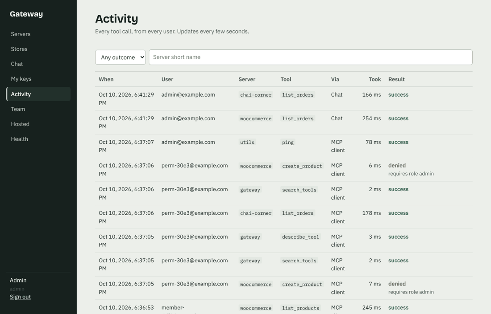

# Urumi: WooCommerce hosting with a team MCP gateway on Kubernetes

**Demo video:** https://drive.google.com/file/d/1lYyodz_sGm0mDxgblnD7DoU3yYhYmq-v/view?usp=sharing

A WooCommerce store on Kubernetes, an MCP server for it written from scratch, and a **team MCP gateway**. Admins connect MCP servers once. Every team member then uses all of them through **one MCP endpoint** (Claude Code, Cursor, MCP Inspector) and through a **chat agent** in the dashboard, with:

- per-user API keys (or an OAuth browser login)
- role-based tool permissions
- a full audit log

The bonus is included: users can **create and delete whole stores** from the dashboard. Each store gets its own namespace, database and MCP server, connected to the gateway automatically.

Everything is one Helm chart. Local (k3d) and production (k3s on a VPS) differ only in values files.

**Docs:** [System design and tradeoffs](docs/DESIGN.md) · [Threat model](docs/THREAT_MODEL.md) · [What was verified, and how](docs/VERIFICATION.md) · [Demo video and Round-2 walkthrough guide](docs/WALKTHROUGH.md)

```
                       ┌──────────────────────────── namespace: urumi ──────────────────────────────┐
Browser ──► Ingress ──►│ store.<domain> ─► WordPress + WooCommerce ─► MariaDB (PVC)                  │
 (Traefik)             │ app.<domain>   ─► dashboard (React, nginx)                                  │
                       │   /api /mcp /oauth /.well-known ─► gateway ──┬─► woo-mcp ─► WordPress REST │
MCP client ───────────►│   (Claude Code, Cursor, Inspector)  (2+ pods) ├─► notes-mcp (PVC)          │
                       │   chat agent runs inside the gateway,         ├─► utils-mcp                 │
                       │   as the logged-in user                       └─► Postgres (PVC): users,    │
                       │                                                   key hashes, servers,      │
                       │ store-provisioner (bonus) ─► Kubernetes API      encrypted creds, audit    │
                       └────────────────────────────────────│───────────────────────────────────────┘
                              namespace: store-<slug> (one per created store)
                              WordPress + MariaDB + woo-mcp, own Secret, PVCs, Ingress <slug>.<domain>,
                              ResourceQuota, LimitRange, default-deny NetworkPolicies
```

|  |  |
|---|---|
| **Servers**: status, tools, why a server is unreachable, permissions | **Chat**: each tool call drawn as the route it took |
|  |  |
| **Stores** (bonus): one namespace per store | **Activity**: every call: who, server, tool, when, how long, result |

## Repo layout
| Path | What |
|---|---|
| `services/woo-mcp` | WooCommerce MCP server (Python, official MCP SDK, Streamable HTTP). Tools: `list_products`, `create_product`, `list_orders`, `get_order`, `update_order_status` |
| `services/gateway` | FastAPI app. It is an MCP **client** to every upstream and an MCP **server** at `/mcp`, and it holds the REST API, auth (keys + OAuth), audit, chat agent, tool search and hosted servers. `app/provisioner.py` + `app/stores.py` are the store provisioner (same image, different command). |
| `services/dashboard` | React (Vite) dashboard served by nginx |
| `services/demo-mcp` | `notes` and `utils` MCP servers: the 2nd and 3rd upstreams. Both expose `ping`, so name collisions are visible. |
| `deploy/charts/urumi` | the Helm chart: `values.yaml`, `values-local.yaml`, `values-prod.yaml`; store bootstrap scripts in `files/` |
| `deploy/prod` | production secrets script + cert-manager ClusterIssuer |
| `scripts/` | live checks (`dod_check.py`, `standout_check.py`, `oauth_check.py`, `stores_check.py`), demos (`scale-demo.sh`, `upgrade-rollback-demo.sh`), `restore-store.sh`, `smoke.sh` |
| `docs/` | design, threat model, verification log, walkthrough guide |

---

## Run it locally (k3d)

**Prerequisites:** Docker, [k3d](https://k3d.io) v5, kubectl, Helm 3, make, Python 3.12+ (for tests and checks). k3d is k3s in Docker, so local behaves like the VPS and **enforces NetworkPolicies** (plain kind does not). Give Docker at least 4 CPUs and 6 GB of RAM (8 GB if you'll create extra stores).

```bash
make cluster                     # k3d cluster "urumi", host ports 80/443 -> Traefik
make build import                # build the 4 images, load them into the cluster
make install LLM_API_KEY=<key>   # helm upgrade --install with values-local.yaml
#   add STORES=1 for the multi-store bonus, HOSTED=1 for hosted MCP servers
make logs-setup                  # watch WordPress + WooCommerce install (first start: 2-4 min)
make status
```

**On Windows:** the easiest path is WSL (`wsl --install`, then run everything above in the Ubuntu terminal, with the
project in the Ubuntu home folder). Without Ubuntu, install Docker Desktop, Git for Windows, k3d, kubectl, Helm and
Python 3.12 (`winget install -e --id Docker.DockerDesktop` / `Git.Git` / `k3d.k3d` / `Kubernetes.kubectl` / `Helm.Helm` /
`Python.Python.3.12`) and run the `make` recipes' commands by hand in **Git Bash** (`make` itself isn't installed):
```bash
k3d cluster create urumi -p "80:80@loadbalancer" -p "443:443@loadbalancer" --wait
for s in woo-mcp demo-mcp gateway dashboard; do docker build -t urumi/$s:local services/$s; done
k3d image import -c urumi urumi/woo-mcp:local urumi/demo-mcp:local urumi/gateway:local urumi/dashboard:local
helm upgrade --install urumi deploy/charts/urumi -n urumi --create-namespace -f deploy/charts/urumi/values-local.yaml \
  --set secrets.llmApiKey=gsk_... --set stores.enabled=true \
  --set stores.apiServerCIDR=$(kubectl get endpoints kubernetes -o jsonpath='{.subsets[0].addresses[0].ip}')/32
./scripts/netpol-check.sh
python -m venv .venv && .venv/Scripts/pip install -r services/gateway/requirements-dev.txt -r services/woo-mcp/requirements-dev.txt -r services/demo-mcp/requirements-dev.txt
ADMIN_PW=$(kubectl -n urumi get secret urumi-secrets -o jsonpath='{.data.bootstrap-admin-password}' | base64 -d) .venv/Scripts/python scripts/dod_check.py
```
The repo forces LF line endings (`.gitattributes`), since the store's setup scripts run in Linux containers.

**Local domain approach:** `*.urumi.localtest.me` is public wildcard DNS that resolves to `127.0.0.1`, so there's nothing to edit in `/etc/hosts`, and created stores (`<slug>.urumi.localtest.me`) work too. k3d maps host port 80 to Traefik.

- storefront: <http://store.urumi.localtest.me> · WordPress admin: `/wp-admin` (user `shopadmin`)
- dashboard: <http://app.urumi.localtest.me>
- MCP endpoint: `http://app.urumi.localtest.me/mcp`

If you're offline, add `127.0.0.1 store.urumi.localtest.me app.urumi.localtest.me` to `/etc/hosts`.

**Credentials** are generated by the chart and live only in a Kubernetes Secret:
```bash
kubectl -n urumi get secret urumi-secrets -o jsonpath='{.data.bootstrap-admin-password}' | base64 -d; echo   # dashboard: admin@example.com
kubectl -n urumi get secret urumi-secrets -o jsonpath='{.data.wp-admin-password}' | base64 -d; echo           # WordPress: shopadmin
```

**LLM for the chat agent:** any OpenAI-compatible chat-completions endpoint with tool calling. The default is Groq's free tier with `openai/gpt-oss-120b` (verified with a real key), so `make install LLM_API_KEY=gsk_...` is enough. `openai/gpt-oss-20b` and `qwen/qwen3.8-27b` also work (`--set gateway.llmModel=...`). Groq retires models; list the current ones with `curl https://api.groq.com/openai/v1/models -H "Authorization: Bearer $KEY"`. The free tier allows about 8,000 tokens per minute: if several multi-step questions come quickly, the agent waits out the limit (up to a minute) rather than failing. Pause briefly between prompts when recording. For Gemini, add `--set gateway.llmBaseUrl=https://generativelanguage.googleapis.com/v1beta/openai --set gateway.llmModel=gemini-2.0-flash`. The key is stored in the Secret like every other credential. A local Ollama on your laptop is blocked by the gateway's egress NetworkPolicy (private ranges are denied on purpose); run it in-cluster or allow-list it.

**If isolation looks broken after a restart:** after a laptop or Docker restart we've seen k3s's NetworkPolicy controller come back without enforcing anything. The policies exist, but nothing is blocked. `make netpol-check` detects it in seconds; `docker restart k3d-urumi-server-0` fixes it.

**If the first start hangs:** `kubectl -n urumi logs deploy/wordpress -c wp-setup` shows the store bootstrap. It needs outbound HTTPS to wordpress.org to download WooCommerce, pinned by `store.woocommerceVersion`. `kubectl -n urumi logs deploy/woo-mcp` shows the MCP server.

## How to use it

**Place an order:** open the storefront, open a product, *Add to cart*, *Checkout*, pick **Cash on delivery**, *Place order*. The order appears in WordPress admin under WooCommerce → Orders.

**Connect an external MCP client:** go to Dashboard → *My keys* → *Generate key*. The page prints ready-to-paste snippets.
```bash
claude mcp add --transport http urumi http://app.urumi.localtest.me/mcp --header "Authorization: Bearer umk_..."
```
For Cursor (`~/.cursor/mcp.json`) or MCP Inspector, use URL `http://app.urumi.localtest.me/mcp` with header `Authorization: Bearer umk_...`. Tools appear as `woocommerce__list_orders`, `notes__add_note`, `utils__calculate` and so on, plus `<store>__*` for every created store.

**Or log in with OAuth instead of a key:** add the server **without** a header (`claude mcp add --transport http urumi http://app.urumi.localtest.me/mcp`). The client discovers the gateway's OAuth endpoints from its `401`, registers itself, and opens a browser page where you sign in with your dashboard email and password.

**Chat agent:** Dashboard → *Chat*. Each tool call is drawn as the route it took (you → gateway → server → tool) with its arguments, result and timing. The calls appear in *Activity* under your name with source "chat".

**Admins** also get:
- **Servers**: add, edit, disable or remove by URL plus credential; see status, tools and "why unreachable"; restrict tools to admins.
- **Team**: invite → one-time link; roles; issue and revoke keys.
- **Activity**: the audit log of every call.
- **Health**: per-server calls, error rate, p50/p95 latency.
- **Hosted**: run an MCP server from a container image.

**Stores (bonus):** *Stores* → *Create store* → a name. In 2–4 minutes it is **Ready**, with its own storefront at `<slug>.urumi.localtest.me` and its tools (`<slug>__list_orders`, …) in the gateway for everyone. Delete removes everything.

## Demo script (the definition of done)

1. **Store:** a shopper orders with COD on the storefront → visible in WooCommerce admin.
2. **User A (admin), chat:** *"Create a product called Blue Mug for 12.50"* → it's on the storefront. Order it by hand. *"What orders came in today?"* → the agent returns that order.
3. **User B:** in *Team*, invite B (member), open the link and set a password. As B, generate a key and add only URL + key to Claude Code, Cursor or Inspector → every enabled server's tools are listed. Ask the orders question. Then a two-server prompt: *"Summarise today's orders and save the summary as a note"* (`woocommerce__list_orders` + `notes__add_note`).
4. **Revoke:** in *Team → All keys*, revoke B's key → B's next call gets `401`.
5. **Disable:** in *Servers*, disable `utils` → its tools vanish from the chat and from the client's next `tools/list`.
6. **Kill an upstream:** `kubectl -n urumi scale deploy/notes-mcp --replicas=0`. Scaling to zero keeps it down long enough to show; a plain pod delete is replaced in seconds. Within about 10 s the dashboard shows *Unreachable – connection refused*, a call to a `notes__` tool returns *"Upstream 'notes' is unreachable (…)"*, and everything else keeps working. `--replicas=1` brings it back.
7. **Audit:** *Activity* shows every call above under the right user.

The same flow is scripted. Run `make venv` once, then:
```bash
make netpol-check     # are NetworkPolicies actually enforced right now? (run before a demo)
make dod-check        # all of the above against the running install, through the Ingress (needs the LLM key)
make standout-check   # tool permissions, tool search, observability
make oauth-check      # OAuth with the official MCP SDK client
make stores-check     # bonus: two stores, cross-store chat, isolation, delete (install with STORES=1)
make helm-test        # in-cluster smoke test
```

## Production-like VPS (k3s)

Same chart, different values file. On a fresh Ubuntu VPS (4 GB RAM minimum, 8 GB recommended) with ports 22/80/443
open and DNS for `store.`, `app.` and `*.` your domain pointing at it, one command does everything:

```bash
sudo DOMAIN=you.duckdns.org EMAIL=you@example.com LLM_API_KEY=gsk_... ./deploy/vps/bootstrap.sh
```

[`deploy/vps/bootstrap.sh`](deploy/vps/bootstrap.sh) installs k3s, builds and imports the images, installs
cert-manager with a Let's Encrypt HTTP-01 issuer, creates the secrets out-of-band, runs `helm upgrade --install` with
`values-prod.yaml`, waits for real certificates, then runs `helm test`, `netpol-check`, the OAuth check and the
definition-of-done check over HTTPS. It is idempotent: re-run it to deploy new code.
**Step-by-step with a free Azure for Students VM and a free DuckDNS name: [docs/DEPLOY_VPS.md](docs/DEPLOY_VPS.md).**

Things the script handles that a manual install tends to miss:
- the chart's default-deny NetworkPolicies also cover cert-manager's temporary HTTP-01 solver pods, in the main
  namespace and in every provisioned store, or certificates are never issued;
- the solver Service is `ClusterIP`, because store namespaces' quota forbids NodePorts;
- HTTP redirects to HTTPS (Traefik middleware), since session cookies are `Secure`;
- in-cluster DNS sends `*.<domain>` to Traefik directly, so cert-manager's self-check and WordPress's calls to its own
  URL (wp-cron, WooCommerce's Action Scheduler) don't depend on the cloud's hairpin NAT.

The manual equivalent, for a cluster you already have:
1. cert-manager: `helm install cert-manager jetstack/cert-manager -n cert-manager --create-namespace --set crds.enabled=true`,
   then `kubectl apply -f deploy/prod/clusterissuer.yaml` with your email in it.
2. Images: build the four images and push them to a registry (set `images.*`), or on one node
   `docker save … | sudo k3s ctr images import -`.
3. Secrets (`secrets.create=false` in prod): `LLM_API_KEY=... ./deploy/prod/create-secrets.sh urumi`.
4. `helm upgrade --install urumi deploy/charts/urumi -n urumi --create-namespace -f deploy/charts/urumi/values-prod.yaml --set domain=<domain> --set secrets.adminEmail=<email>`

**What changes from local, through values only:**

| | `values-local.yaml` | `values-prod.yaml` |
|---|---|---|
| domain | `urumi.localtest.me` (wildcard DNS → 127.0.0.1) | your domain |
| scheme / TLS | http | https; `ingress.tls` via cert-manager, Secure cookies |
| storage | cluster default (local-path) | `storage.className`, larger PVCs |
| secrets | generated by the chart, stable across upgrades (`lookup`) | `secrets.create=false`, created by script (or SOPS / sealed-secrets) |
| images | `urumi/*:local`, `k3d image import` | registry tags |
| gateway | 1 replica | 2 replicas + HPA (2–6) + PodDisruptionBudget |
| resources | defaults | larger WordPress and MariaDB |

## Upgrades and rollback

`helm upgrade` is the only deploy path. Every release is a numbered revision:

- **Gateway, MCP servers, dashboard:** change an image tag or value and rerun `helm upgrade`. Rolling update with `maxUnavailable: 0`, a `preStop` drain and readiness gating, so there's no dropped request (measured: 0 failures in about 5,500 requests across restarts). Add `--atomic` and a failed upgrade rolls itself back.
- **Store:** WordPress core follows `images.wordpress`; WooCommerce follows `store.woocommerceVersion`. The setup sidecar converges the store on the PVC to those versions, up or down. Before every `helm upgrade` and `helm rollback`, a hook dumps the store database to the `store-backups` PVC.
- **Rollback:** `helm history urumi -n urumi`, then `helm rollback urumi <rev> -n urumi`. If an upgrade migrated the WooCommerce database, restore the dump taken just before it: `./scripts/restore-store.sh` lists dumps, `./scripts/restore-store.sh <file>` restores one.
- `make rollback-demo` runs all of it: a good upgrade (`WC=10.4.3 WP_IMAGE=wordpress:6.8-apache` upgrades the store too), a broken upgrade that auto-rolls back, and a manual rollback.

## Stand-out items and the bonus: what, where, verified how

All of these were run against a live cluster through the real Ingress: the final round on **k3d with a real LLM (Groq)**, the rest on k3s. [docs/VERIFICATION.md](docs/VERIFICATION.md) has the details and the bugs found on the way.

| # | Item | Where | Verified |
|---|---|---|---|
| 1 | Production-like VPS | `deploy/vps/bootstrap.sh`, `values-prod.yaml`, `deploy/prod/*`, [docs/DEPLOY_VPS.md](docs/DEPLOY_VPS.md) | `bootstrap.sh` run end to end against Pebble (Let's Encrypt's ACME test server): real HTTP-01 certificates for the app, the store and each newly provisioned store; HTTP→HTTPS redirect; HTTPS storefront order, OAuth over TLS, Secure cookies. Not run on an internet-facing VPS: the demo is recorded on k3d; the VPS path is ready to run as one command. |
| 2 | Tool permissions | `ToolPolicy`, `service.py`; *Servers → Permissions* | hidden from list, rejected on call, hidden from search, audited as `denied` |
| 3 | OAuth on the gateway | `app/oauth.py` (RFC 9728/8414/7591, PKCE S256, rotating refresh tokens, RFC 8707 resource check) | the official MCP SDK OAuth client, end to end; Claude Code connects |
| 4 | Many tools | `app/toolsearch.py`: `gateway__search_tools` / `describe_tool` / `call_tool`; automatic above 40 tools, or header `X-Gateway-Tools: search` | search → describe → call, permissions respected, audit shows the real tool |
| 5 | Hosted MCP servers | `app/hosted.py`, *Hosted* page, chart `hosted.*` (`make install HOSTED=1`) | deployed from an image, isolated (can't reach DBs or the K8s API), removed cleanly |
| 6 | Security hardening | SSRF guard (`ssrf.py`), Fernet-encrypted credentials, default-deny NetworkPolicies, non-root read-only containers, least-privilege RBAC + admission policy | NetworkPolicies probed pod-to-pod; SSRF bypass attempts blocked; provisioner denied outside `store-*` |
| 7 | Scaling | stateless MCP, rate limit shared in Postgres, HPA + PDB, startup lock; `make scale-demo` | 3 replicas: SDK sessions spread across pods; exactly one rate-limit budget across replicas |
| 8 | Observability | `/metrics` (in-cluster only), *Health* page (`/api/stats`), unreachable reasons, optional ServiceMonitor + alerts | metrics and stats checked live |
| 9 | Upgrades and rollback | section above, `store-backup.yaml`, `restore-store.sh`, `helm test` | store 6.7→6.8 / WooCommerce 10.3→10.4 and back; atomic rollback; restore tested |
| ★ | **Bonus: multi-store provisioning** | `app/stores.py`, `app/provisioner.py`, `templates/stores.yaml`, *Stores* page (`make install STORES=1`) | concurrent create, cross-store chat, isolation, quota failure with a clear reason, retry, provisioner killed mid-provisioning, clean delete (namespace, PVs, registration) |

## Tests
`make venv && make test` runs 39 tests:
- **woo-mcp** against a mocked WooCommerce
- **demo servers**
- **the gateway end to end over real HTTP:**
  - namespacing and collisions
  - credential isolation
  - audit attribution
  - roles and the chat tool loop
  - slow and dead upstreams
  - key revocation and the SSRF guard
  - OAuth, tool search and the shared rate limit
  - hosted manifests
  - store manifests and the provisioner reconcile loop (incl. a delete-vs-ready race)

`make verify` lints and renders the chart in every configuration. CI (`.github/workflows/ci.yaml`) runs tests, the dashboard build, chart lint plus kubeconform, and image builds.

## Known limits
- The chat agent doesn't stream tokens; it returns the final answer plus the tool trace. Conversation history lives in the browser tab.
- Schema changes use `create_all` (additive only). A destructive change would need Alembic migrations first.
- Rate limiting is a fixed one-minute window: a burst of up to 2× is possible at a window boundary.
- One WordPress replica per store (ReadWriteOnce volume), so a store upgrade has a short storefront outage.
